# Wall-World

**局部观测下的预测式世界模型与势能导航**

[总体框架](#总体框架) · [世界模型](#2-世界模型) · [势能导航](#3-势能导航) · [实验结果](#4-实验与结果) · [快速运行](#5-快速运行) · [详细使用说明](USAGE.md)

## 摘要

Wall-World 研究如何结合局部视觉、运动反馈和内部预测完成目标导航。世界模型交替执行动作驱动的状态预测与真实观测修正，并读出八方向可达性；导航器在内部展开短期候选轨迹，根据目标吸引与历史远离点形成的势值选择路径，无需额外训练目标条件 Actor 或 Q 网络。在30张同生成器新地图上，最终系统成功率为 **83.33%**，HER GRU-SAC 采样基线为 **66.67%**；代价是更高的推理开销。

## 总体框架

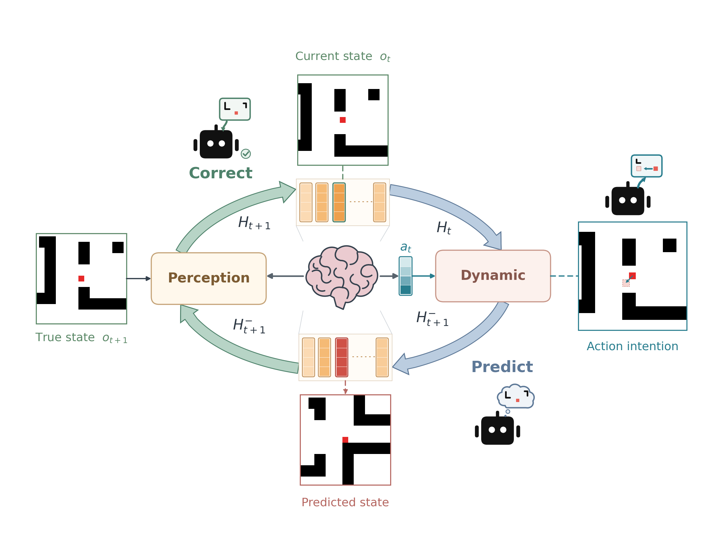

*动作驱动状态预测，真实观测修正预测状态，形成以隐状态 $`H`$ 为核心的循环。*

## 1. 任务与方法概览

环境由七个房间及门洞构成，地图为896×896像素。Agent 每步获得224×224局部 RGB 和真实执行位移，目标以回合起点为原点给出；八个动作对应八邻接方向，成功移动一格（14像素），碰撞则原地不动。导航不读取完整墙体图。

世界模型及可达性头在导航时冻结，导航器通过内部预测和真实观测修正完成闭环决策。下面两段为导航器原型的演示，用于说明局部观测与执行过程；定量评估见第4节。右侧全局轨迹仅用于可视化。

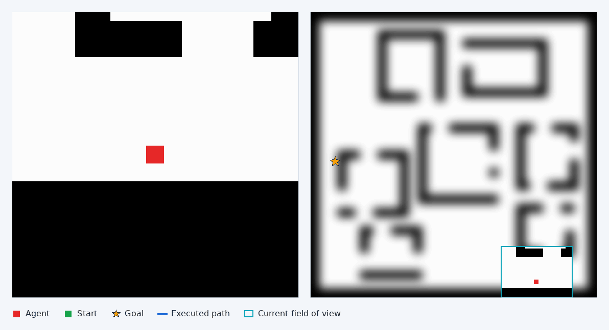

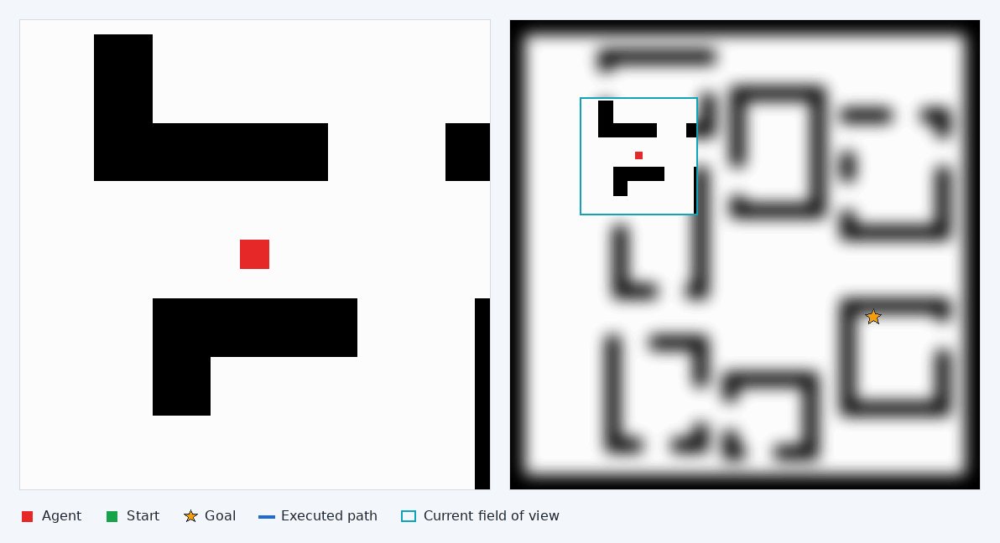

## 2. 世界模型

<p align="center">
  <strong>推理框架</strong><br>
  <a href="asset/framework/inference.png">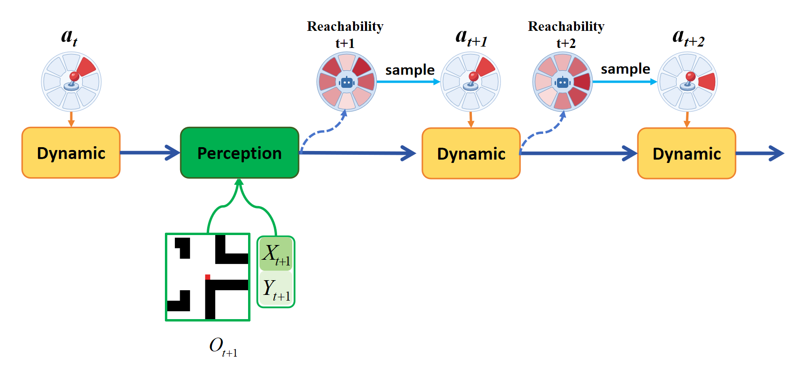</a>
</p>

<p align="center">
  <strong>训练框架</strong><br>
  <a href="asset/framework/train.png">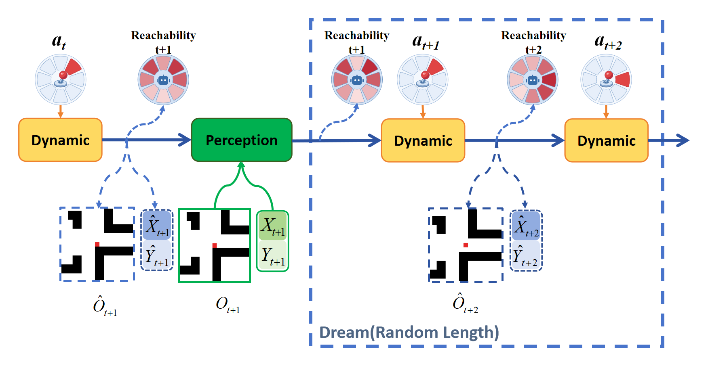</a>
</p>

*图中的图像预测与红色方向编码为概念示意。实际视觉头输出256×384特征 token，不进行 RGB 重建；示意红阶不是实测可达性数据。*

### 状态预测与观测修正

记 $`o_t`$ 为局部图像，$`a_t`$ 为八方向动作，$`Z_t=E(o_t)`$ 为冻结 DINOv2 ViT-S/14及已有 LoRA 提取的特征，$`p_t=\sum_{s=1}^{t}\Delta p_s`$ 为运动反馈累计的相对格坐标。世界模型维护 $`H_t\in\mathbb{R}^{8\times256}`$：

```math
H^-_{t+1}=D_\theta(H_t,a_t),\qquad
H_{t+1}=O_\phi(H^-_{t+1},Z_{t+1},p_{t+1}).
```

初始状态为 $`H_0=O_\phi(0,Z_0,0)`$。Dynamic 使用动作与 token 身份条件调制的四层 AdaLN 模块及残差门控。图中的 Perception 对应代码中的 Observation：视觉和坐标各自通过 cross-attention 提出修正 $`U_v,U_p`$，独立 sigmoid 门控后融合：

```math
H_{t+1}=\mathcal{N}\left(H^-_{t+1}+g_v\odot U_v+g_p\odot U_p\right),\qquad
\mathcal{N}(h)=\frac{h}{\max(\mathrm{RMS}(h),10^{-8})}.
```

$`\odot`$ 为逐元素乘法；$`g_v,g_p`$ 为逐特征门控，不进行模态 softmax。$`\mathcal{N}`$ 对每个 token 固定 RMS 归一化。**$`H`$ 是世界模型唯一循环隐状态**；完整导航器另有坐标累加器、历史点表等运行状态。

### 读出与 Dream

可达性头输出八个独立分数 $`q_a(H)`$；物理读出联合建模碰撞事件 $`C`$ 和相对坐标 $`X,Y`$：

```math
q_a(H)=\sigma(\ell_a(H)),\quad a\in\{0,\ldots,7\},\qquad
P(C,X,Y\mid H)=P(C\mid H)P(X\mid H,C)P(Y\mid H,C).
```

$`\ell_a`$ 是动作 $`a`$ 的预测 logit，$`C=1`$ 表示碰撞。八个可达分数不要求和为1。给定动作，联合读出在“移动一格”和“原地碰撞”两个合法结果之间解码。Dream 从当前修正状态 $`\widehat H_0=H_t`$ 出发，仅递推 $`\widehat H_{k+1}=D_\theta(\widehat H_k,a_k)`$；不访问未来观测、真实未来坐标或墙体图。

### 离线训练

训练沿录制轨迹使用真实动作，随机采样 $`L\sim U\{1,\ldots,6\}`$，连续 $`L`$ 次 Dynamic 后进行一次真实观测修正。每一步预测状态均接受对应真实下一时刻的监督，优化目标为：

```math
\mathcal{L}=
\mathcal{L}_{\mathrm{coord}}+\mathcal{L}_{\mathrm{visual}}+\mathcal{L}_{\mathrm{collision}}
+0.2\mathcal{L}_{\mathrm{reach}}+0.05\mathcal{L}_{\mathrm{align}}.
```

坐标项为真实碰撞条件分支上的软标签交叉熵；视觉项为归一化特征的 L1 误差；碰撞项为二元交叉熵。可达性只监督实际执行方向，标签为动作是否成功移动，碰撞样本权重为4；在观测修正位置，可达性项取先验、后验损失的均值，$`\mathcal{L}_{\mathrm{align}}`$ 为两者八个 Bernoulli 分布的平均 JS 散度。视觉编码器及 LoRA 均冻结。

## 3. 势能导航

### 目标吸引与局部排斥

设 $`p`$ 为位置、$`g`$ 为目标，$`r_i`$ 为第 $`i`$ 个远离点，$`t_i`$ 为其首次登记步数。导航使用“越大越好”的势值：

```math
\Phi_t(p)=
\frac{\rho}{\sqrt{\|p-g\|^2+\rho^2}}
-\beta\left(1-e^{-\|p-g\|^2/\ell^2}\right)
\sum_i 2^{-(t-t_i)/T_{1/2}}
\left[1-\frac{\|p-r_i\|^2}{R^2}\right]_+^2.
```

其中 $`[x]_+=\max(x,0)`$，$`t`$ 为真实执行步数，距离以格计。默认 $`\rho=8,\beta=0.5,\ell=1,R=8,T_{1/2}=32`$。第一项吸引目标；第二项抑制历史停滞区域，8格以外影响为零，强度每32步减半，并在目标处关闭。存在安全候选且没有安全预测到达路径时，若最高路径分数不超过 $`10^{-6}`$，或最近20步满足重复与停滞条件，则登记当前位置；重复登记不刷新首次时间。一次 Dream 评分固定使用当前 $`t`$。

以下热图展示真实执行中势值、远离点和轨迹的变化。全局墙体用于绘图，不作为导航器输入。

<p align="center">
  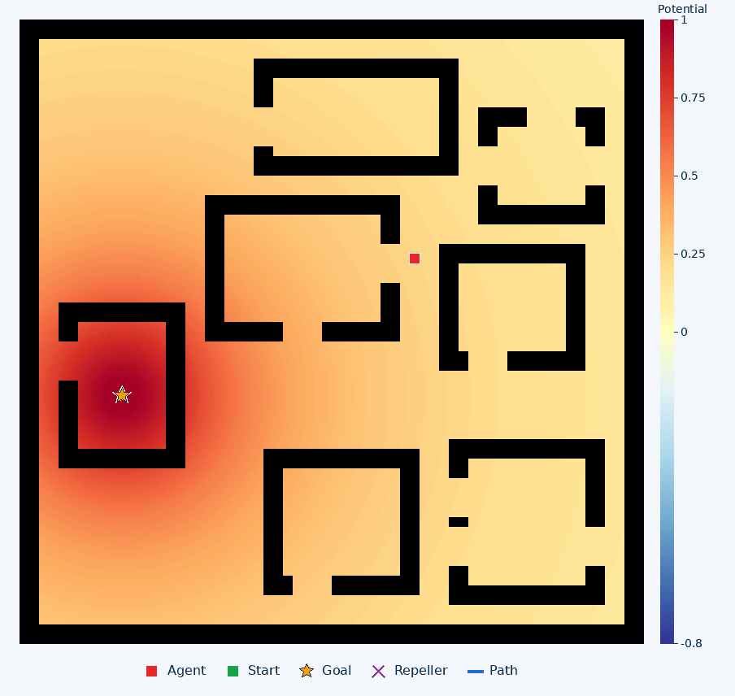
  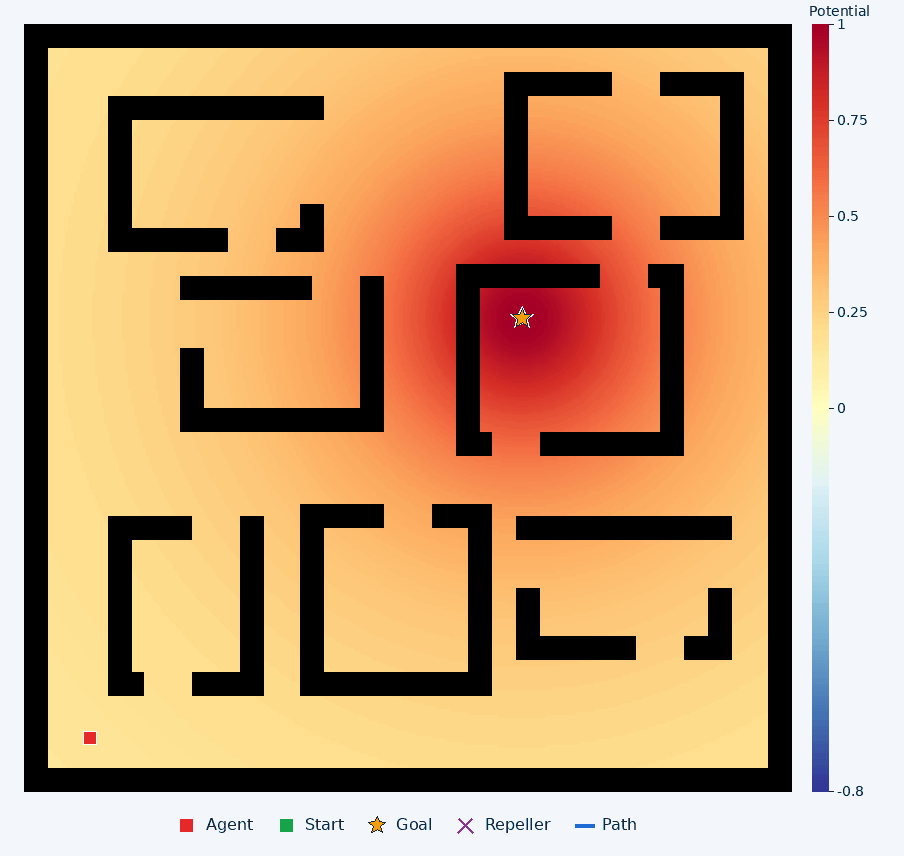
</p>

### 可达性引导的候选搜索

首动作的基础提议 $`b_0(a)=1/8`$；后续提议围绕本条路径首动作的方向角形成高斯分布：

```math
b_k(a)\propto\exp\!\left[-\frac{\Delta\theta(a,a_0)^2}{2\sigma_k^2}\right],\qquad
\pi_k(a)=0.9\frac{b_k(a)q_a(\widehat H_k)}{\sum_{a'}b_k(a')q_{a'}(\widehat H_k)}+0.1b_k(a).
```

$`\Delta\theta`$ 是折回 $`[-180^\circ,180^\circ)`$ 的方向角差；后五步 $`\sigma_k`$ 依次为60°、45°、35°、30°、30°。$`\pi_k`$ 才是动作采样分布；加权质量过小时退回 $`b_k`$。每批生成128条候选：120条采样，另8条覆盖全部首方向，最长展开6步。

<p align="center">
  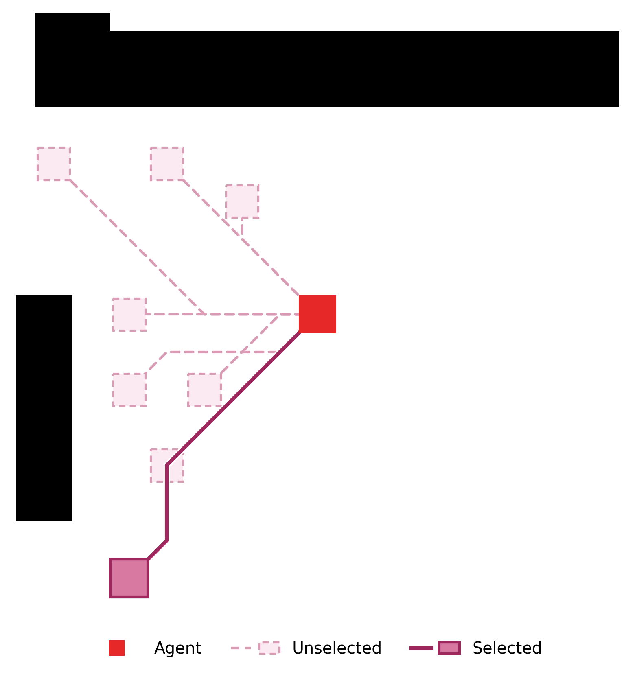
</p>

对安全候选集合 $`\mathcal{S}`$，记第 $`j`$ 条路径预测终点为 $`\widehat p_{j,L_j}`$，$`L_j\le6`$，当前真实位置为 $`p_t`$：

```math
G_j=10\,\mathbf{1}[\widehat p_{j,L_j}=g]
+\Phi_t(\widehat p_{j,L_j})-\Phi_t(p_t),\qquad
P(j)=\frac{e^{G_j/\tau}}{\sum_{m\in\mathcal{S}}e^{G_m/\tau}},\quad\tau=0.02.
```

任一步预测碰撞、或首动作未通过当前状态的一步预测守卫，均剔除该候选。导航从 $`P(j)`$ **随机抽取路径**，最多执行前4步；每一步重新观测修正和检查守卫，出现运动失配或新通路时提前重规划。最多尝试两批，无安全候选则停止。势能用于路径评分，不直接转换为解析梯度动作。

## 4. 实验与结果

### 世界模型多步预测

在78张测试地图上选取500个片段。每个片段先接收9次真实观测，再连续执行9步无观测预测；每个深度500个样本，共4,500个预测点，预测期间不回灌未来观测。

*图例表示训练时无观测递推的最大步数，实际长度在1至该上限间均匀采样；橙色曲线为当前模型（上限6步）。展开上限同时改变观测修正频率，对照反映二者的共同影响。*

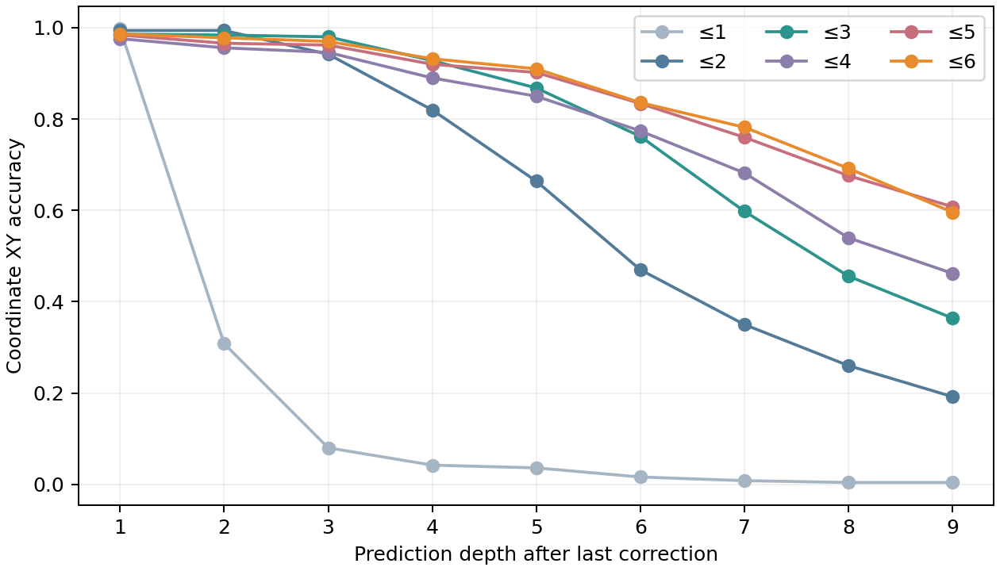

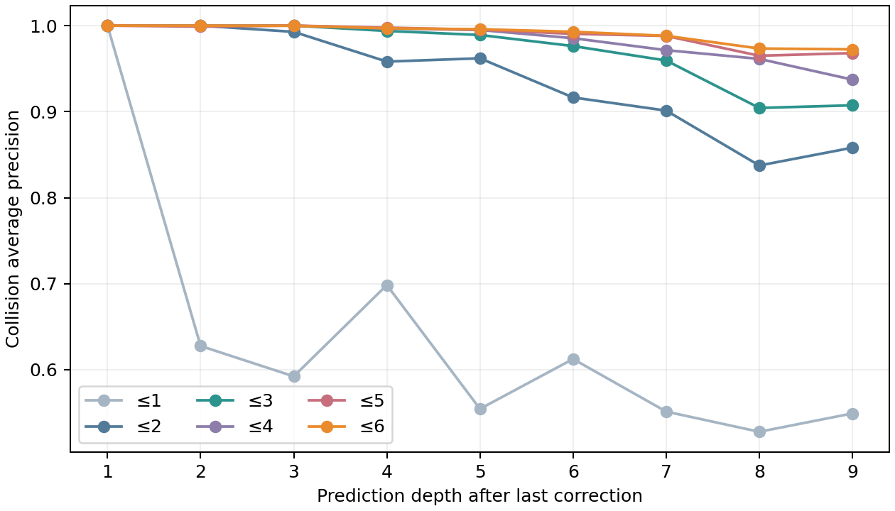

位置准确率要求两轴同时完全正确：逐点准确率为 **85.36%**，完整9步均正确的片段占 **56.20%**；平均坐标L1误差为 **0.457格**，定义为两轴绝对误差之和的均值。碰撞 **AP（平均精度，Average Precision）为99.43%**。第9步位置准确率为59.60%，长程预测仍有明显误差。

*评估给定真实坐标观测历史，采用单个训练种子。视觉特征预测的总体L1误差尚未优于保留最后观测的基线。*

### 闭环导航

30张未参与调参的同生成器新地图，各设置外到内（A）和内到外（B）任务，真实最短路为49–62步且需绕行；每回合上限256步。本方法与 SAC 采样每任务运行两个种子，各120回合；确定性 argmax 每任务一次，共60回合。

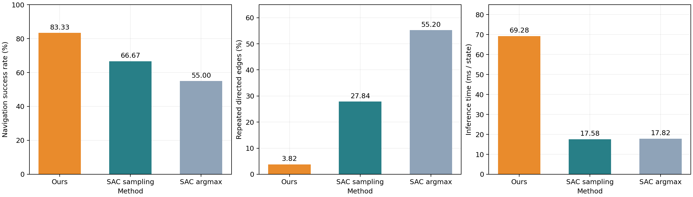

| 指标 | 本方法 | HER GRU-SAC 采样 | HER GRU-SAC argmax |
| --- | ---: | ---: | ---: |
| 回合数 | 120 | 120 | 60 |
| 成功率 | **83.33%（100/120）** | 66.67%（80/120） | 55.00%（33/60） |
| 平均碰撞／回合 | **0** | 2.32 | 10.03 |
| 回头次数／总步数 | **4.75%** | 9.40% | 23.83% |
| 重复有向边／总步数 | **3.82%** | 27.84% | 55.20% |
| 固定观测平均耗时／状态 | 69.28 ms | **17.58 ms** | 17.82 ms |

行为率由总事件数除以总真实步数计算。耗时为 RTX 4060 上的同设备、同观测测试，每种方法360次测量，包含视觉编码、状态更新与决策，排除环境、渲染和文件保存。[图表数据与评估设置](docs/results_summary.json)

### 结果分析

- **到达与循环行为：**相对 SAC 采样，成功率提升16.67个百分点，重复边比例明显更低。收益主要来自A类任务（53/60对34/60）；B类为47/60对46/60，差异很小。
- **计算代价：**本方法平均推理耗时约为 SAC 采样的 **3.94倍**。结果反映完整模型、搜索、守卫和外部历史共同作用，不能单独归因于世界模型。

下面每列为同地图、同任务、同执行种子的配对轨迹：上行为本方法，下行为 SAC 采样。

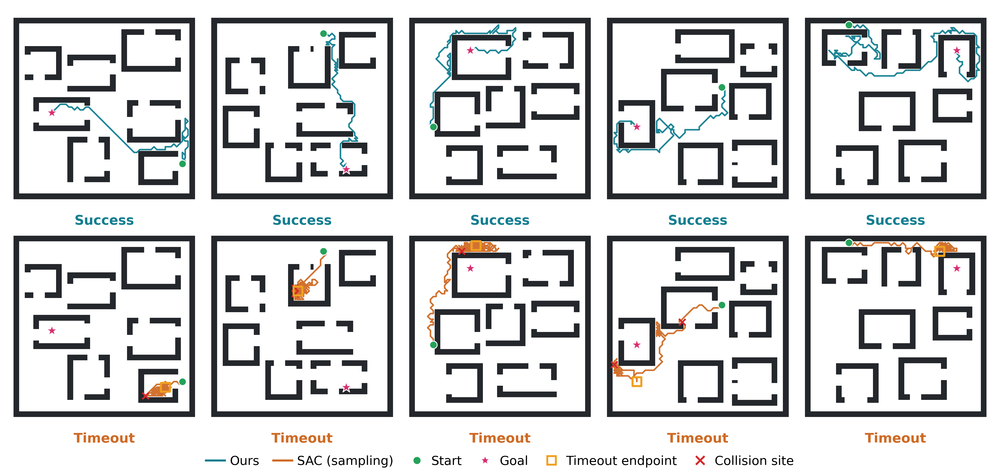

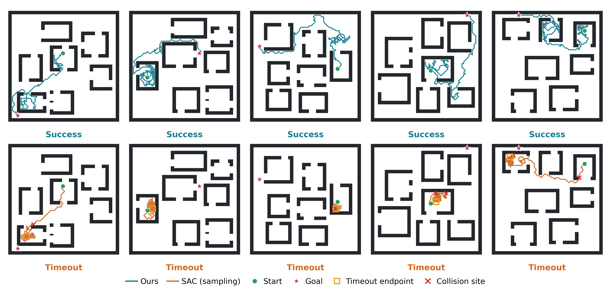


## 5. 快速运行

在本发布目录中运行。安装匹配硬件的 PyTorch 后，获取 Git LFS 权重并安装其余依赖：

```bash
git lfs install
git lfs pull
python -m pip install -r requirements.txt
```

CPU 最小推理示例（默认配置为 CUDA/BF16，此处显式覆盖）：

```python
import torch
from agent import Agent
from world import make_world

torch.set_num_threads(4)
agent = Agent.from_config("config", device="cpu", precision="float32")
world = make_world("config/world.yaml", model_config=agent.config)
image, _ = world.reset(seed=19001)
h = agent.reset(image)
print(agent.predict(h)["reachability"])  # 八个独立分数
dream = agent.dream_rollout(torch.tensor([[0, 0, 3, 3, 1, 1]]))
```

权重校验、完整导航循环、HER GRU-SAC 接口、动作约定、离线数据格式、训练和断点恢复见[运行与接口说明](USAGE.md)。默认训练配置为30次优化器更新，用于流程检查，可在配置中调整训练预算。

## 相关项目与致谢

视觉骨干使用 [DINOv2](https://github.com/facebookresearch/dinov2)，本地实现及许可证见 [DINOV2_LICENSE](model/vendor/DINOV2_LICENSE)。相关背景包括 [DINO-WM](https://github.com/gaoyuezhou/dino_wm)、[JEPA-WMs](https://github.com/facebookresearch/jepa-wms)、[DreamerV3](https://github.com/danijar/dreamerv3) 和 [TD-MPC2](https://github.com/nicklashansen/tdmpc2)。
